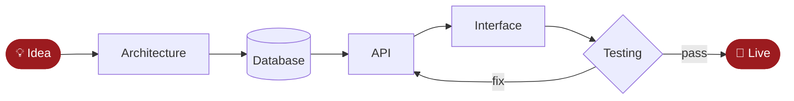
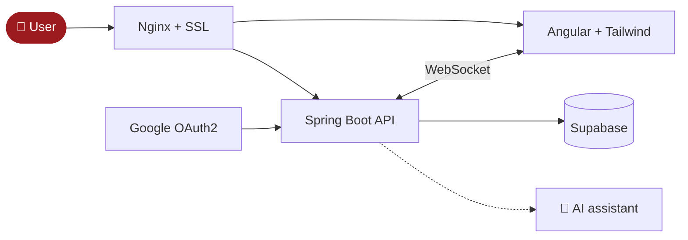

<div align="center">


<a href="https://maiawall.com"></a>

<br/>

[](https://maiawall.com)
[](https://port.maiawall.com)
[](https://br.fiverr.com/wallace_maia?public_mode=true)
[](https://wa.me/5535910036806)

</div>

<br/>

## `01` &nbsp; The Company

```bash
$ ./maiawall --about

  Maiawall is a dev brand that turns business needs into real,
  working digital products: from the first landing page to
  a full management system. One team, zero hand-offs.
```

<table>
  <tr>
    <td width="33%" valign="top">
      <h3>🌐 Websites</h3>
      Landing pages, institutional sites and portfolios built to load fast and convert.
    </td>
    <td width="33%" valign="top">
      <h3>⚙️ APIs</h3>
      RESTful backends with JWT authentication, authorization and clean architecture.
    </td>
    <td width="33%" valign="top">
      <h3>📊 Dashboards</h3>
      Admin panels and internal tools to see and control your operation.
    </td>
  </tr>
  <tr>
    <td width="33%" valign="top">
      <h3>🛒 Business Systems</h3>
      E-commerce, ERP and CRM platforms shaped around how your company works.
    </td>
    <td width="33%" valign="top">
      <h3>🤖 SaaS Products</h3>
      Full applications with AI-assisted features, ready for real users.
    </td>
    <td width="33%" valign="top">
      <h3>☁️ Deploy & DevOps</h3>
      Dockerized deployments with CI/CD so shipping stays boring.
    </td>
  </tr>
</table>

### How a project flows



<br/>

## `02` &nbsp; Flagship: SplitHub

<div align="center">

[](https://splithub.maiawall.com)

</div>

**A shared expense platform** where groups organize, split and settle expenses without the awkward math.



| | |
|---|---|
| 👥 **Groups** | Equal, custom and individual splitting |
| ✅ **Settling** | Payment confirmation workflow |
| 🔐 **Security** | JWT auth, authorization, Google OAuth2 login |
| ⚡ **Real-time** | Live updates via WebSockets |
| 🤖 **AI** | Assistant integrations |
| 📱 **Responsive** | Works across every screen size |

<sub>**Stack:** Java 21 · Spring Boot · Spring Security · Spring Data JPA · Hibernate · Angular · TypeScript · Tailwind CSS &nbsp;|&nbsp; **Infra:** AWS EC2 · Docker/ECR · Nginx · Certbot · Supabase</sub>

<br/>

## `03` &nbsp; The Developer


```yaml
name: Wallace Candido Maia Sousa
role: Full Stack Developer
founder_of: Maiawall
location: Uberlândia, Minas Gerais, Brazil
education: B.Sc. Information Systems @ UFU
core_stack: [Angular, Spring Boot]
also_works_with: [Node.js, Express, NestJS, Next.js, AWS]
principles: [Clean Code, SOLID, ship real things]
focus: RESTful APIs · scalable web applications
goal: turn ideas into functional digital products
open_to: [client projects, freelance, internships, jobs]
```

<details open>
<summary><b>🧰 Tech stack</b></summary>
<br/>

<p align="center">
  
  <br/>
  
  <br/>
  
  <br/>
  
  <br/>
  
</p>

<p align="center"><sub>RxJS · Angular Material · Spring Security · JWT · JUnit</sub></p>

</details>

<br/>

## `04` &nbsp; Activity

<div align="center">

<picture>
  <source media="(prefers-color-scheme: dark)" srcset="https://raw.githubusercontent.com/wallacemaia2007/wallacemaia2007/output/github-contribution-grid-snake-dark.svg">
  <source media="(prefers-color-scheme: light)" srcset="https://raw.githubusercontent.com/wallacemaia2007/wallacemaia2007/output/github-contribution-grid-snake.svg">
  
</picture>

<br/>


</div>

<br/>

## `05` &nbsp; Let's build something

```bash
$ ./contact --project "your idea"

  > Status: open for client projects, freelance and opportunities
  > Reply time: fast
```

<div align="center">

[](https://wa.me/5535910036806)
[](mailto:wallacemaia2007@gmail.com)
[](https://www.linkedin.com/in/wallacemaia-dev/)
[](https://www.instagram.com/wallace_maia._/)
[](https://br.fiverr.com/wallace_maia?public_mode=true)

<sub>If you're working on something involving Angular, Java, Spring Boot or modern web apps, say hi.</sub>


</div>
